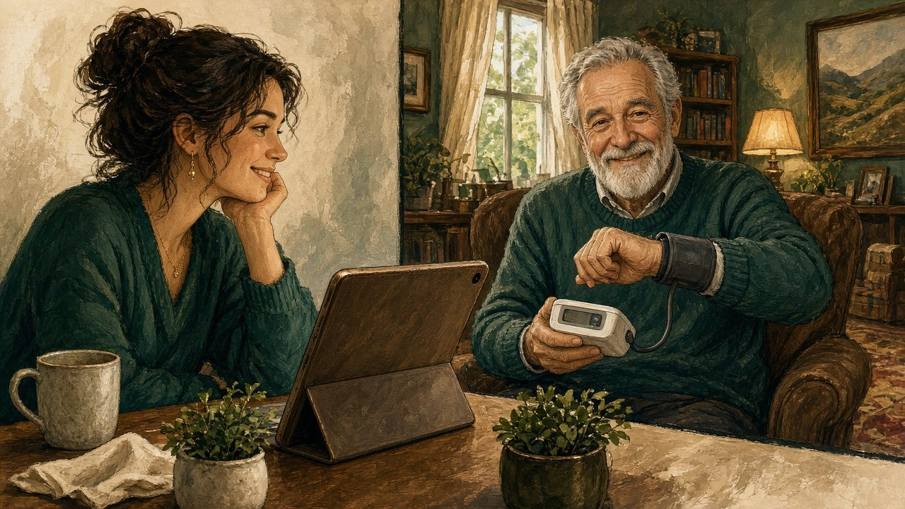
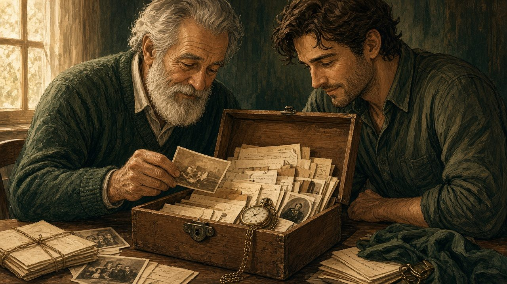

# Carelink: вся семья в одном месте

### Семейная ОС для хранителей и владельцев семьи: родные приглашаются по email и входят через Workspace, данные о здоровье и телефоны хранятся по 152‑ФЗ, уведомления приходят в веб и в мобильное приложение

`Живой лонгрид · версия от 13.10.2026` `Автор проекта: Слава Якимов` `Пометка «Концепт» — идея ещё не подтверждена`

> **Сцена первая. Вымышленный пример.** Пятница, вечер. В одной квартире четыре человека и четыре экрана. Мама в соседней комнате листает рабочий чат. Папа на кухне смотрит видео про ремонт. Пятнадцатилетний сын в наушниках, у него своя жизнь в соцсетях. Бабушка живёт в другом городе. Она звонила днём, но никто не взял трубку: были заняты. Все дома, все любят друг друга. И каждый совершенно один.

Эта сцена вымышлена, но в ней узнает себя почти любая семья. Важное разбросано по чатам и заметкам: анализы, полисы, телефоны врачей и родных. Пожилые родители далеко, и сложно вовремя узнать, что нужна помощь. Каждый знает свою часть, а общей картины нет ни у кого. Эту проблему решает **Carelink** — «операционная система для семьи». Её автор Слава Якимов.

Что Carelink умеет уже сейчас. Владелец создаёт семью и приглашает родных по email, они входят через **Workspace**. Хранители ведут общие данные: здоровье, контакты, телефоны. Данные о здоровье и телефоны хранятся по **152‑ФЗ**. Важные события приходят уведомлениями, в вебе (**CarelinkWeb** на Next.js, авторизация **CarelinkAuth** на Go) и в мобильном приложении на React Native. Всё остальное в этом тексте — дорожная карта: идеи из черновика манифеста, блокнотов и банка CarelinkMemory, помеченные `Концепт`. Образы астронавтов взяты из концепции CosmoFusion DAO: это фон, на котором удобно объяснять задуманное, а не часть продукта. И мы будем возвращаться к честному вопросу: **крепкая семья или новая цифровая клетка?**

Под всем этим лежит простая мысль. Реальность семьи складывается из слов, которые мы говорим друг другу, и из состояния, в котором мы их говорим. Из раздражения и спешки вырастает одна семья, из спокойствия и внимания — другая. Поэтому Carelink не про контроль и не про список функций, а про ощущение, что жизнь в ваших руках: **мы сами создаём свою семейную жизнь**, а **Carelink помогает вернуться друг к другу**.

### Из чего состоит Carelink

Carelink складывается из четырёх частей. Вход и регистрацию для всей семьи обеспечивает единый сервис авторизации и регистрации на Go. Рядом работает единый self-hosted сервис, который также должен быть в «S-Project» [?]. На телефоне Carelink — это мобильное приложение с поддержкой Qwen. А для разработчиков предусмотрены маркетплейсы.

> **Как читать этот текст.** Всё, что не найдено в источниках и пока остаётся идеей, помечено `Концепт`. Сценарии в рамках выдуманы, чтобы показать механику; имена Анна, Сергей, Алиса и бабушка Вера взяты из примеров в материалах проекта. Цифры (30 минут, 3 секунды, 30% дохода и другие) взяты из проектных документов. Это проектные параметры, а не результаты измерений.

---

## 1. Одинокие астронавты

*Иллюстрация 01 · Рядом, но врозь: каждый в своём телефоне*

*Зачем это Carelink: каждый член семьи видит ситуацию только со своей стороны, поэтому семье нужно общее место для данных и договорённостей.*

Представьте астронавта посреди бесконечного космоса. Вокруг звёзды, туманности, далёкие галактики, но всё это он видит только из одной точки. С этого образа начинается сайт CosmoFusion DAO: на звонке 13.10.2026 Слава назвал его исходной концепцией Carelink. Сайт задаёт два вопроса, которые легко перенести на кухню обычной квартиры. Если астронавт ошибся в расчёте траектории, кто его поправит? Если отказали приборы, кто даст другие данные?

В документах Carelink у этого состояния есть название: **атомизация**. Документы проекта (белая книга, бизнес-документация, дорожная карта) описывают проблему коротко. Люди одиноки даже в браке. Родственные связи слабеют. Старших отодвинули на край семейной жизни: по формулировке бизнес-документации, им остаётся «только дарить подарки». Дети живут в соцсетях. Пары ссорятся и не понимают, куда идти за помощью. Семьи берут кредиты под проценты в банке, хотя могли бы поддержать друг друга. В кризис некому помочь.

Ни одна из этих бед не новая. Новое здесь в том, как проект на них отвечает. Carelink не обещает вернуть «как было раньше» и не собирается учить семью жить правильно. Он предлагает инфраструктуру. Миссия в белой книге звучит так: «создать цифровую инфраструктуру для построения сильного Рода».

> «Вместо конфликта — диалог, вместо одиночества — участие, вместо лайков — забота».
>
> — из документа «Миссия и философия экосистемы CareLink»

На сайте CosmoFusion у одиночества три симптома, и все три легко узнать в семье. **Централизация**: решения принимает узкий круг, а остальные видят только последствия. **Непрозрачность**: логика решения остаётся чёрным ящиком, и непонятно, почему выбрали именно так. **Беспамятство**: каждая миссия начинается с нуля, ошибки забываются, удачные решения не передаются дальше. Узнаёте? «Потому что я так сказал». «Мы это уже обсуждали» — но никто не помнит, чем закончилось. Один и тот же спор о посуде в сотый раз, как в первый.

> **Вопрос читателю.** Вспомните последний семейный спор. Кто в нём решал? Знали ли остальные, почему решили именно так? Помнит ли кто-нибудь, чем закончился такой же спор год назад?

---

## 2. Стекло шлема

*Иллюстрация 02 · Разные взгляды: у каждого в семье своя сторона*

*Зачем это Carelink: в будущем помощник будет мягко подсвечивать искажения в семейном споре. `Концепт`*

Вторая глава CosmoFusion называется «Стекло шлема отражает только то, что астронавт хочет видеть». В стекле отражается Земля. Красиво, но это не сама Земля, а её искажённое отражение. А если в стекле вообще не Земля, а собственные ожидания?

Для семьи это, пожалуй, самая точная метафора во всём проекте. В конфликте каждый смотрит со своей планеты. У мамы, у папы, у подростка и у бабушки своя правда, и каждая неполная. Дело не в том, что кто-то лжёт. Стекло шлема у всех кривое, и у каждого по-своему.

В концепции AI-обмена слепыми зонами, о которой речь пойдёт ниже, искажения сведены в список из семи. Шесть взяты прямо с сайта CosmoFusion. Седьмое добавлено из исследовательского блокнота, где разбирается давление авторитета в семье. Сам список «семи искажений визора» `Концепт`:

1. **«Вижу то, что хочу»** — избирательное восприятие. Визор пропускает только удобное.
2. **Предвзятость подтверждения.** Ищем доводы, что мы правы, и не замечаем того, что этому противоречит.
3. **Эффект якоря.** Первое впечатление окрашивает всё, что было потом. Если в начале вечера прозвучало «ты опять опоздал», остаток вечера оценивается через эту фразу.
4. **Эхо-камера.** Мы советуемся с теми, кто с нами согласен: с подругой, с мамой, с форумом. Кажется, что так думают все.
5. **Групповое мышление.** Когда большинство в семье уже решило, несогласному проще промолчать. Единодушие оказывается иллюзией.
6. **«Помню только последний случай»** — эвристика доступности. Яркое недавнее воспоминание перевешивает всю картину: «ты *никогда* не помогаешь».
7. **Давление авторитета.** Голос старшего, громкого или того, кто платит, звучит весомее, чем его доводы. Блокнот проекта прямо называет эту проблему: «менее влиятельные члены семьи» боятся «немедленной критики со стороны „авторитетных“ родственников».

Здесь важна интонация. В материалах проекта сказано, что AI **мягко подсвечивает** искажения и никого не обвиняет. Это не «ты предвзят». Это скорее «похоже, в этом споре многое держится на одном эпизоде с прошлой недели. Посмотрим на месяц целиком?»

> «Стекло шлема отражает ожидания, а не мир».

> **Сценарий. Вымышленный пример.** Сергей уверен, что Анна «вечно недовольна». Если посмотреть внимательнее, эта уверенность держится на двух ярких ссорах из последних. Помощник не спорит с Сергеем и не встаёт на сторону Анны. Он предлагает Сергею посмотреть, какими были последние четыре пятницы по их общим ответам в Пульсе. Три из четырёх совпали. Так выглядит эвристика доступности: она проявилась и сразу ослабла, и никто не услышал обвинения.

---

## 3. Тысяча астронавтов

*Иллюстрация 03 · Много голосов: вместе семья видит целое*

*Зачем это Carelink: семья, где каждый добавляет свою часть — контакты, здоровье, договорённости, — видит общую картину.*

Что будет, если на одну галактику одновременно посмотрят тысячи астронавтов с разных планет? Ответ CosmoFusion умещается в одну фразу: вместе они видят полную картину. Истина, говорится на сайте, рождается «не в одиночестве гения», а в коллективном поиске.

Carelink переносит эту идею с масштаба DAO на масштаб одной семьи. Тысяча астронавтов здесь — это мама, папа, подросток, бабушка, крёстный. Правда каждого из них неполная, но вместе они видят больше. Вся глава CosmoFusion в проекте помечена `Концепт`: это источник истории, а не готовая функция.

### Маяк, а не судья

Самое важное решение в этой части манифеста касается роли искусственного интеллекта. В CosmoFusion AI — это «космические маяки», которые освещают путь. Маяк не решает, куда плыть кораблю. Он показывает, где скалы. В Carelink это сформулировано так: AI собирает взгляды всех, находит повторяющиеся паттерны, показывает конфликт глазами другого и предлагает варианты. **Решает семья.**

У проекта есть путь решения из семи шагов: выслушать всех, затем AI находит закономерности, затем открытое обсуждение, затем договорённость (один член семьи — один голос, с учётом возраста), затем проба, затем разбор результата и, наконец, запись в бортовой журнал.

**Бортовой журнал семьи** отвечает на «проблему памяти». Он хранит, что решили, почему и чем всё закончилось. Благодаря журналу семья не начинает каждый спор с нуля.

### Трезубец Милля

Третий опорный элемент взят у Джона Стюарта Милля, из его рассуждения о свободе слова, известного как «трезубец». CosmoFusion сводит его к трём возможностям любого спора, а Carelink переводит их на язык семьи:

- **Если ты прав**, несогласие других проверит и укрепит твою позицию.
- **Если ты прав частично**, тебе нужна правда другого, чтобы увидеть целое.
- **Если ты неправ**, открытый разговор тебя поправит.

Вывод следует из всех трёх случаев сразу, поэтому **право голоса есть у каждого**. Ребёнок нужен в обсуждении не из вежливости, а потому, что в любом из трёх случаев его взгляд что-то добавляет.

> «Если ты прав, несогласие тебя укрепит. Если прав частично, тебе нужна правда другого. Если неправ, разговор тебя поправит».

### Четыре стадии и правда в движении

Сайт описывает путь от одиночки к общему разуму в четыре шага, и Carelink повторяет его для семьи. Первая стадия — **одинокий астронавт**: каждый сам по себе. Вторая — **экипаж**: семья договаривается. Третья — **маяки**: AI помогает видеть. Четвёртая — **общий разум**: у семьи есть память и правила.

Последний принцип CosmoFusion звучит как «правда в движении». Окончательных ответов нет. Договорённости пересматривают по мере того, как семья растёт: подросток взрослеет, бабушке нужно больше заботы, в семье появляется новый человек.

Проект переносит и роли сайта: **Исследователь** предлагает идеи, **Критик** бережно сомневается, **Создатель** воплощает решения, **Наблюдатель** следит за выполнением договорённостей, **Хранитель журнала** ведёт память, **Посол** служит мостом к родне и Совету старейшин. От токен-наград, которые есть в CosmoFusion, проект осознанно отказывается. Возможны благодарности или XP, но «токены за вклад» помечены как `Концепт` с прямо названным риском: превратить заботу в сделку.

> **Вопрос читателю.** Кто в вашей семье Критик, который бережно сомневается? Есть ли у него право голоса или его сомнения считают капризом?

---

## 4. Государство в государстве

*Иллюстрация 04 · Сова Carelink: память и забота семьи*

Самая смелая формулировка проекта есть в белой книге и в продуктовых требованиях. Carelink хочет превратить семью из «сожителей» в «государство в государстве» со своей экономикой, законами и поддержкой. Звучит громко. Устроено это вполне буднично: через бумаги, которые семья пишет сама себе.

### Сначала личный кодекс

До всякой Конституции каждый пишет **личный кодекс**, причём дети с 7 лет. По источникам, кодекс держится на трёх китах: **ценности**, **границы** (физические, эмоциональные, цифровые) и **потребности**. Кодексы пишут заранее, и это не формальность. Цель названа прямо: чтобы при обсуждении Конституции одна сторона не продавила остальных.

У кодекса есть «приватный черновик» с AI-помощником, чтобы ребёнок не писал под диктовку. Перед публикацией AI проверяет текст на токсичность. Остальные члены семьи отмечают «Ознакомлен». У кодексов есть версии.

### Теневой кодекс

Это одна из самых тонких идей во всех материалах, и она подтверждена блокнотом проекта. Каждый пункт кодекса можно сделать «личным» или «публичным». Есть и третий уровень доступа, `SYSTEM_ONLY`, «видит только ИИ». Пункты этого уровня блокнот называет ядром **«Теневого кодекса»**. AI-гармонизатор учитывает их, когда ищет компромиссы, но содержание не раскрывает остальным, «чтобы избежать обид».

Пример из блокнота — потребность супруга побыть одному. Сказать вслух «мне иногда нужно, чтобы вас не было рядом» почти невозможно, не обидев. А гармонизатор может учесть эту потребность при составлении семейного расписания и никого не задеть. Блокнот подчёркивает и защитную роль: теневой кодекс позволяет детям и «менее влиятельным» членам семьи записать свои настоящие границы и не бояться немедленной критики.

> «Правила выше личностей».
>
> — принцип Семейной Конституции (The Family Code)

### Конституция и ратификация

Из личных кодексов собирается **Семейная Конституция**, «операционная система семьи». AI-гармонизация находит «зелёные зоны», то есть общие ценности, и они становятся статьями. Она же находит «красные зоны», то есть конфликты, и для них визард переговоров предлагает компромиссы. У документа простая и почти торжественная структура: преамбула, затем I. Ценности, II. Законы, III. Традиции. В итоге получается PDF-постер «на холодильник».

Конституция начинает действовать только после **ратификации**, когда её «подпишут» все участники. Право голоса у детей появляется с 12 лет. Есть пробный период. Каждая поправка принимается кворумом и создаёт новую версию, а история версий хранится. В источниках это прямо называется защитой от газлайтинга.

Примеры статей в материалах очень бытовые. Папа предлагает убирать телефоны за ужином, сын — играть в настолки по пятницам. Есть и статья «никогда не ложимся спать в ссоре». Отдельно сформулирована статья 1.2: **критикуем только поступки, не личность**. Оскорбление личности считается нарушением.

Бывают и правила по месту. Например, у «Дома бабушки» свои договорённости, и они включаются, когда семья туда приезжает.

### То, что не может отменить никто

Над всеми статьями стоит **Safety Override**. Никакое правило семьи не может отключить SOS, звонки родителям и геолокацию. Даже если все взрослые проголосуют «за», это не сработает. Это единственное место в «государстве», где закон написан не семьёй и не обсуждается.

**Версии Конституции на блокчейне Velas** `Концепт`. Идея прозвучала на звонке 13.10.2026: хранить хеши версий в сети Velas, чтобы история не менялась. В исследовательских блокнотах Velas не упоминается, а в концепции 16 открыт вопрос, нужен ли блокчейн или хватит локальной истории.

> **Сценарий. Вымышленный пример.** Ужин. Сын тянется к телефону. Раньше в этот момент папа сказал бы «я сказал, убери». Теперь звучит «статья 3», и все за столом знают, о чём речь: три месяца назад сын сам за неё проголосовал. Спорят уже не люди, а договорённость. Сын может предложить поправку в следующее воскресенье, и для этого есть процедура.

> **Вопрос читателю.** Какие три статьи вы бы внесли в Конституцию своей семьи? И согласился бы с ними ваш двенадцатилетний ребёнок?

---

## 5. Вход через разговор

Как «государство» выглядит в телефоне? На звонке 13.10.2026 прозвучал ответ, который меняет всю архитектуру интерфейса. Главная точка входа — **чат-бот**, «похожий на Jarvis, но для закрытых семейных отношений». Остальные экраны вторичны. `Концепт`

Логика понятна. Человек пишет или говорит обычными словами, а помощник открывает нужное: дневник, календарь, Пульс, Конституцию, перевод денег. В блокнотах AI-медиатор и AI-биограф тоже работают через диалог, а голосовой ввод назван способом сделать продукт доступнее. В манифесте отмечено, что помощник должен опираться на того же AI-медиатора, соблюдать этический фильтр и правило «мы не судим». Отдельного чат-бота как главного экрана в источниках нет. Это предложение.

> **Сценарий. Вымышленный пример.**
>
> **Человек:** Напомни, что мы решили про телефоны за ужином.
>
> **Carelink:** Статья 3 вашей Конституции: «за ужином телефоны лежат в корзине». Принята всеми 12 марта. Показать текст?
>
> **Человек:** И когда у бабушки день рождения?
>
> **Carelink:** В субботу. Добавить в семейный календарь напоминание за 2 дня?

Остаются открытые вопросы из концепции 01. Какие функции будут доступны только через чат, а какие через экраны? Будет один бот на всю семью или личный у каждого? Ответ на второй вопрос, как мы увидим в одиннадцатой главе, определяет почти всё.

---

## 6. Дневник, который никто не прочтёт

У каждой ссоры есть минута перед ней: человек ещё не сказал главного, но уже готов это выкрикнуть. Carelink предлагает прожить эту минуту с телефоном, а не с партнёром.

**Дневник эмоций** по источникам — личный и закрытый инструмент. Обиду можно сначала проговорить телефону. AI-инспектор замечает агрессию и сильное напряжение в тексте и в голосовых записях и предлагает «остыть», прежде чем начинать разговор. Если человек снова и снова пишет «устал», AI подсказывает, что ему, возможно, нужен отдых или помощь.

> **Сценарий. Вымышленный пример.**
>
> **Анна** *(голосом)*: Достало, он опять ничего не сделал по дому, я устала.
>
> **Carelink:** Слышу, что ты очень устала. Это уже третий раз за неделю. Может, сначала отдых, а разговор завтра? Могу помочь сформулировать просьбу.

**Теневой дневник** `Концепт`. На звонке прозвучала идея пойти дальше и сделать дневник, который технически невозможно прочитать или незаметно переписать. Записи шифруются сквозным шифрованием. Хеш-цепочка не даёт тихо изменить прошлое. Ключ разделён на доли (схема Шамира) между доверенными людьми. В блокнотах этого нет: там описаны только закрытый Дневник эмоций и неизменяемые логи. Открытые вопросы: сколько долей, у кого они, какой порог восстановления? И один ли это дневник с Дневником эмоций или два разных?

### Медиатор-зеркало

Когда пауза позади, подключается **AI-медиатор**. Источники описывают его очень точно. Он переводит «ты-сообщения» в «я-сообщения»: «ты эгоист» становится «мне не хватает поддержки». Он работает как зеркало: говорит не «ты тиран», а «сейчас ты давишь, и это вызывает агрессию». На резкий тон предлагает безопасную фразу. Если несколько кругов медиации не помогли, предлагает позвать специалиста, а логи передаются только с согласия обоих. Он честно предупреждает: «я робот, а не психолог».

> «Не "ты тиран", а "сейчас ты давишь"».
>
> — принцип AI-медиатора из материалов проекта

> **Сценарий. Вымышленный пример.**
>
> **Сергей:** Ты эгоистка, тебе на нас плевать.
>
> **Carelink:** Это звучит как обвинение. Попробуем так: «Мне не хватает твоей поддержки по вечерам». Отправить этот вариант?
>
> **Сергей:** Ладно, отправь.

---

## 7. Пятница, 20:00

*Иллюстрация 05 · Домашний очаг: ритуалы, к которым возвращаются каждую неделю*

Семью держат смыслы, ритуалы и благодарность, а не ипотека. Эта фраза из манифеста объясняет, почему в Carelink так много повторяющихся механик. Ритуал — это договорённость, которая стала привычкой.

### Пятничный Пульс

В пятницу в 20:00 приходит пуш: «Ваша неделя в 5 вопросах». Пять карточек листаются свайпом: вправо — «да», влево — «нет», вверх — «супер». Темы такие: поддержка, время вдвоём, интимная жизнь, быт и секретный вопрос про сюрприз.

Главная деталь — **результаты закрыты, пока не ответят оба**. Так ответ одного не подстраивается под ответ другого, и это прямая защита от «якоря» и «группового мышления» из второй главы. Потом открывается экран **«Слепые зоны»**: зелёным отмечено то, что совпало, красным то, что разошлось, и AI предлагает одно конкретное действие. Итог наполняет **Бак Любви**.

> **Сценарий. Вымышленный пример.**
>
> **Carelink:** Ваша неделя в 5 вопросах. Анна уже прошла 💙
>
> **Сергей:** → «Я чувствовал поддержку».
>
> **Carelink:** Слепая зона: ты считаешь, что времени вдвоём было достаточно, Анна — нет. Челлендж: прогулка вдвоём в воскресенье без телефонов?

**Утренние, ежедневные и ежемесячные чекапы** `Концепт`. В источниках есть только еженедельный Пульс. Рядом с ним описаны ритуалы с частотой (ежедневно, еженедельно, ежемесячно), ежемесячная серия свиданий и совет про «утреннюю благодарность». Проект предлагает такой ритм: утром одна эмоция и одно «спасибо», днём короткое «как ты?», раз в месяц итог Бака Любви и ритуалов. Открытый вопрос из концепции 06: нужны ли они вообще или пятницы достаточно?

### Игра, в которой выигрывает клан

**Геймификация** в Carelink кооперативная. Растёт не каждый сам по себе, а вся семья: у неё общий опыт, **Family XP**. Уровни такие: Новички, затем Строители (Пульс четыре недели подряд и ведение бюджета), затем Хранители (решают конфликты, вводят ритуалы), затем Династия. В продуктовом контексте между Хранителями и Династией упоминаются ещё Наставники. Есть стрики (например, ужины без телефонов) и ачивки «Железные нервы», «Слово купца», «Огонь Любви» (52 недели Пульса подряд).

Самая интересная деталь здесь — та, где игра себя ограничивает. У повторяющихся дел есть дневной лимит XP. Если родитель назначает ребёнку за дело 10 000 XP, система предупреждает, что такая награда обесценивает труд, и советует около 50.

> «Семью держат смыслы, ритуалы и благодарность, а не ипотека».

Тон игры в проекте пока не определён. Среди вопросов к автору есть такой: насколько игровым должен быть продукт для мамы 65 лет и для пары в кризисе, и где игра становится неуместной, например при разводе или после SOS?

> **Вопрос читателю.** Какой ритуал у вашей семьи уже есть, даже если вы никогда его так не называли? И что с ним станет, если за него начнут давать очки?

---

## 8. Деньги как доверие

«Мы продаём инфраструктуру для счастья, а не банкинг», — так позиционирование сформулировано в продуктовом контексте. Но деньги в Carelink есть, и устроены они как продолжение доверия.

**Семейный банк.** Подросток может занять под 0% на рост: на ноутбук, обучение, хобби. Брать в долг на еду и одежду запрещено. Выплаты не могут превышать 30% подтверждённого дохода ребёнка. Своевременный возврат повышает **рейтинг ответственности** и **лимит доверия**. Юридически это оформлено как «дар с условием возврата» или расписка, а деньги ходят только внутри подтверждённого круга родственников.

Есть и роль **Казначея**. Его действия ограничены защитой: переводы требуют двойного одобрения, критические действия подтверждаются биометрией, а для крупных займов предусмотрены 24 часа «остывания».

За пределами семьи начинается то, что в материалах названо «цифровой деревенской площадью». Это **маркетплейс активностей**: моряк на пенсии учит детей вязать узлы. Есть «Родительский стартап», то есть краудфандинг кружка внутри сообщества. Есть **взаимопомощь «Уставшая мама»**: «Кто погуляет с коляской 2 часа? Плачу 1000₽», и заказ берёт проверенная соседка. И есть совместные закупки со скидкой за объём.

Сам проект называет здесь серьёзные риски. Это «финансовое рабство» детей, против которого введены категории и лимит в 30%. Это нелицензированный P2P-банкинг. И это 152-ФЗ. Платёжные интеграции (ЮКасса, TON) и Web3 упоминаются в источниках только как планы. Открытый вопрос к автору сформулирован прямо: войдут ли финансы в v1 или это далёкое видение?

---

## 9. Предохранитель

*Иллюстрация 06 · Забота на расстоянии: папа показывает давление по видеосвязи*

У любого «государства» есть соблазн стать тюрьмой. Проект знает об этом и называет риск сам: «закрытая секта». Поэтому самая продуманная часть материалов — не про любовь, а про то, что делать, когда инструмент заботы превращают в инструмент контроля.

### «Мне нужна пауза»

**SOS-кнопка** в материалах описана как «цифровой предохранитель». Иконка всегда в шапке. Чтобы включить паузу, нужно удерживать её 3 секунды и подтвердить. Чат блокируется на 30 минут, экран закрывает спокойный синий оверлей с круговым таймером. Партнёр получает сообщение: «Анна взяла паузу. Режим тишины 30 минут». **Звонки в 112 и экстренным контактам не блокируются никогда.** Когда пауза заканчивается, подключается AI-медиатор.

> **Сценарий. Вымышленный пример.**
>
> **Анна** *(держит SOS 3 секунды)*.
>
> **Carelink:** Пауза включена. Чат на 30 минут закрыт. Дыши — я рядом. Звонок 112 доступен всегда.
>
> **Carelink → Сергею:** «Анна взяла паузу. Режим тишины 30 минут».

Сама пауза тоже может стать оружием: можно заставить другого замолчать. Поэтому в неё встроены ограничения. Повторить паузу можно не раньше чем через 2 часа. После трёх нажатий подряд система предлагает Совет или психолога. При частых срабатываниях сигнал может уйти в поддержку в обход Хранителя, а человеку скрыто показываются контакты кризисного центра.

### Защита от того, кто рядом

- **Теневой хранитель.** Система настойчиво советует завести минимум двух хранителей, одного из семьи и одного внешнего, чтобы абьюзер не оказался единственным.
- **Стоп-слова и этический фильтр.** Если звучит угроза насилия или суицида, AI замолкает и показывает контакты кризисных служб.
- **Неизменяемые логи** против газлайтинга и «стирания памяти». Финансы и календарь можно только дописывать, удалить записи нельзя.
- **Финансовая блокада** признана риском. Против неё работают двойное одобрение и автоматическая разблокировка через 24 часа без ответа.
- **Шок совершеннолетия (Data Emancipation).** В 18 лет контроль над данными переходит к самому человеку. Это прямой ответ на «пока мы платим, мы следим».

> «Никакие правила семьи не могут отключить SOS, звонки родителям и геолокацию».

### Детский профиль

У ребёнка с 7 лет есть личный кодекс, с 12 лет голос за Конституцию, роль Скаута и XP за дела. Если ребёнок нажимает SOS, родители получают уведомление («SOS: Алиса просит помощи!»), но не могут войти до конца таймера. Звонки родителям и геолокацию отключить нельзя. Как устроено согласие родителей на детский аккаунт, пока не решено.

**Аудит доступа** `Концепт`. Каждый видит, кто и когда открывал его данные, и может отозвать доступ. Идея прозвучала на звонке. В источниках есть только принцип «логи специалисту только с согласия обоих».

> **Вопрос читателю.** Где для вас граница между «присматривать» и «следить»? Можно ли провести её в коде?

---

## 10. Паттерны, а не приговоры

Всё, о чём говорилось выше, держится на одном умении: замечать повторы. Источники перечисляют, какие паттерны AI отслеживает. Это ты-сообщения, газлайтинг, агрессия и напряжение в тексте и голосе, давление, оскорбления личности и манипуляции: злоупотребление паузой, изоляция, финансовая блокада. Кроме того, маркеры состояния («устал»), быстрый набор текста как признак ссоры, тупик после нескольких кругов медиации (тогда предлагается специалист) и споры между поколениями (тогда предлагается Совет старейшин).

Важно и то, чего в источниках **нет**. Стили привязанности, языки любви и пассивная агрессия в материалах не описаны. Проект не делает вид, что знает о людях больше, чем записано.

**Личный цифровой профиль** `Концепт`. На звонке прозвучала идея собирать профиль человека из его паттернов общения. Первый открытый вопрос к ней этический: кто видит этот профиль и хранится ли он только локально?

> «AI замечает паттерны. Решает семья».

---

## 11. Когда ИИ разговаривают между собой

Эта глава самая новая и самая спорная. Всё в ней `Концепт`.

На звонке 13.10.2026 прозвучала архитектура: **Qwen на телефоне, офлайн**, большая модель «для сборки», сервер авторизации на Go (CarelinkAuth), синхронизация через телефон. Есть и прицел на российскую LLM и офлайн-режим как основной. Из этих элементов вырастает идея, которая в банке памяти проекта оформлена как навык `qwen-ai-to-ai-blind-spots`: **обмен слепыми зонами между AI разных членов семьи.**

### Как это задумано

У каждого члена семьи свой AI на собственном устройстве. Он видит дневник своего человека, его ответы в Пульсе, его кодекс. Больше он не видит ничего. Если бы на семью был один общий AI, он видел бы всех, и это была бы та самая цифровая клетка. Поэтому AI разговаривают друг с другом, но передают не тексты, не цитаты и не записи дневника, а **абстрагированные паттерны поведения**. Это обобщения уровня «в выходные этот участник чаще просит о помощи и чаще получает отказ», а не «вот что она написала в субботу».

Дальше работают три правила:

1. **AI не арбитр.** Он не выносит вердикт, кто прав. Как маяк в третьей главе, он только показывает, где скалы.
2. **Прежде чем что-то сделать** (предложить фразу, челлендж, вопрос), AI прогоняет вывод через **семь искажений визора** из второй главы и через **трезубец Милля**. Не держится ли вывод на одном ярком эпизоде? Не повторяет ли он мнение самого громкого? Что, если мой человек прав только частично?
3. **Решение — это сумма взглядов.** Ни один AI и ни один человек не видит всей картины. Её видят только вместе.

> **Сценарий. Вымышленный пример.** AI мамы замечает в её записях повтор: по воскресеньям она чувствует, что «всё на ней». AI подростка замечает своё: по воскресеньям сын уходит в комнату, потому что «всё равно всё сделают без меня». Тексты остаются на своих устройствах. По каналу идут только два обобщения. Ни один AI не говорит своему человеку «ты неправ». Мама слышит: «Похоже, сын может не знать, что его помощь нужна. Хочешь предложить ему конкретное дело?» Сын получает вопрос: «А что, если в воскресенье тебя ждут?» Что делать дальше, решают они сами.

### Что здесь пока не решено

У концепции честные открытые вопросы, и мы перечисляем их полностью. Где проходит граница «абстрагированного»: можно ли по обобщению восстановить исходный текст? Каждый ли член семьи соглашается участвовать в обмене отдельно, включая детей? Можно ли выйти из обмена и не стать при этом «подозрительным»? Как обмен сочетается с 152-ФЗ, особыми категориями данных и отказом от зарубежных моделей? И что будет, если один AI ошибся, а остальные приняли его паттерн на веру? Против этого и нужен трезубец, применённый к самим машинам.

> «AI не судья. Решение — сумма взглядов».

> **Вопрос читателю.** Вы доверили бы своему AI рассказать AI вашего партнёра не что вы написали, а что с вами происходит? Где для вас проходит эта граница?

---

## 12. Капсула времени

*Иллюстрация 07 · Шкатулка памяти: то, что семья передаёт дальше*

Последняя глава истории о том, что остаётся после человека.

*Иллюстрация 08 · Семейная память: бабушка и внучка над фотоальбомом*

> «Мы уходим, но Род остаётся».
>
> — из материалов проекта о цифровом наследии

**Капсула времени.** Пример из материалов проекта: бабушка Вера записывает видео для внучки к её 18-летию и прикладывает к нему «Золотую акцию», инвестиционный счёт, который откроется в эту дату.

**Совет старейшин и «Запрос мудрости».** Внуки задают вопросы, старшие отвечают голосом, а ответы копятся в **«Золотом фонде семьи»**. Помогает AI-биограф. Это прямой ответ на одну из главных проблем из первой главы: старших, у которых осталась одна роль — «дарить подарки», проект возвращает в жизнь семьи как носителей мудрости.

> **Сценарий. Вымышленный пример.**
>
> **Внучка:** Дедушка, как вы мирились с бабушкой в 1980-м?
>
> **Carelink:** Запрос мудрости отправлен дедушке. Его голосовой ответ сохранится в Золотом фонде семьи.

**Протокол смерти.** Человек заранее выбирает, что будет с его данными: удалить дневник и приватные чаты, передать архив Хранителю или оставить только публичное (мемориализация: публичные фото и «Мудрость»). Открытый вопрос: как подтверждается смерть пользователя?

У проекта есть и **круги доверия**: Ядро (партнёры и дети), затем Род (бабушки, дедушки, крёстные), затем Община (друзья, соседи, единомышленники). **Граф семей по поколениям на Velas** со стейт-машинами связей `Концепт`. Это визуальное древо, связывающее несколько поколений, а в геймификации у него есть соответствие: уровень «Династия».

Так замыкается круг метафоры. Одинокий астронавт видел галактику из одной точки. Род, у которого есть память, видит её из многих точек сразу: в пространстве, потому что у каждого своя планета, и во времени, потому что смотрят несколько поколений.

---

## 13. Что Carelink даёт семье уже сейчас

Мы обещали вернуться к вопросу «крепкая семья или цифровая клетка?». Ответ проекта — начинать с малого и проверяемого. Вот что работает сегодня:

- **Семья в одном месте.** Владелец создаёт семью, хранители ведут общие данные. Мы советуем двух хранителей, чтобы ни один человек не держал всё в своих руках.
- **Приглашение по email.** Родные получают письмо и входят через Workspace. Видеть семью могут только те, кого пригласили.
- **Здоровье и телефоны.** Данные о здоровье и контакты родных хранятся по 152‑ФЗ.
- **Уведомления.** Важное приходит вовремя: в вебе и в мобильном приложении.

Всё остальное из этого текста — кодексы и Конституция, Пульс, дневник, медиатор, семейный банк, SOS, обмен паттернами между AI, капсула времени — пока `Концепт`, требует подтверждения. В материалах есть и расхождения, которые нужно решить до того, как эти идеи станут функциями:

- **Порядок запуска.** Дорожная карта, заметки от 11.02.2026 и CareLink_v2_Full предлагают разные первые шаги. В разработке сейчас аккаунты, семьи и вступление по приглашению.
- **Пара или Род?** Пульс и SOS рассчитаны на пару, Конституция — на несколько поколений.
- **Четыре «Хранителя».** Термин означает и администратора семьи, и роль в v2, и уровень игры. Их нужно развести.
- **Интонация.** Манифест выбирает принцип **мы не судим** и платформу для любых семей, включая неполные и смешанные.
- **Особые данные.** Пульс и дневник затрагивают особые категории данных по 152‑ФЗ; для них соответствие закону ещё нужно подтвердить.

Обещания проекта при этом сформулированы ясно, и их можно проверять. Мы не продаём ваши данные. Видеть семью могут только те, кого вы пригласили. Мы не судим. Безопасность важнее любых правил.

> «Любовь превращается в заботу, а забота — в развитие».
>
> — из документа «Миссия и философия экосистемы CareLink»

> **Вопросы читателю — напоследок.**
>
> Где сейчас лежат анализы и телефоны врачей ваших родителей?
>
> Кого из родных вы пригласили бы в семью первым и кто стал бы вторым хранителем?
>
> Какую функцию Carelink вы бы запретили первой, чтобы он не стал клеткой?

Это живой текст: каждая пометка `Концепт` — приглашение к спору. Метафора CosmoFusion о тысяче взглядов здесь только фон. Главное в другом. Ни одна функция не сделает семью счастливой сама по себе, и никакой контроль не удержит близких рядом. Семью создают слова, которые мы выбираем, и состояние, из которого говорим: спокойное, открытое, без обиды и гонки. Сначала человек возвращается к себе, потом к своим. Жизнь семьи в её собственных руках: **мы сами создаём свою семейную жизнь**. А **Carelink помогает вернуться друг к другу**.

---

## 14. ИИ в Carelink — не судья, а секретарь

*Иллюстрация 09 · Секретарь, а не судья: ИИ помогает записать и сформулировать, а не выносит приговор*

*Зачем это Carelink: за столом «тысячи астронавтов» нужен тот, кто фиксирует договорённости и бережно помогает услышать друг друга, а не тот, кто ставит оценки.*

Представьте длинный семейный стол, за которым сидят люди с разных «планет»: у каждого свой темп, своя усталость, свой страх быть неуслышанным. Спор разгорается не потому, что кто-то плохой, а потому что у каждого в голове — свой черновик разговора. На таком столе больше всего не хватает не «судьи», а **секретаря**: того, кто записывает, что уже решили, напоминает о паузе, помогает переформулировать фразу так, чтобы её можно было услышать.

Carelink складывает эту роль из того, что уже описано в материалах проекта. **AI-медиатор** не говорит «ты тиран» — он предлагает безопасную «я-фразу» и честно предупреждает: «я робот, а не психолог». В третьей главе этой истории ИИ сравнивают с **маяком**: он показывает, где скалы, но не решает, куда плыть кораблю. В десятой — короткая формула: «AI замечает паттерны. Решает семья». В одиннадцатой — правило **AI не арбитр**: он не выносит вердикт, кто прав.

> «Мы не судим».
>
> — принцип, который манифест выбирает для платформы

Секретарь здесь — не новая кнопка в интерфейсе, а **интонация** всех этих функций. Записать итог в **бортовой журнал семьи**, чтобы следующий спор не начинался с нуля. Предложить перевод с «ты-сообщения» на «я-сообщение», когда человек уже остыл. Мягко подсветить искажение визора — «похоже, вы держитесь за один эпизод» — без приговора личности. Помочь сформулировать просьбу в дневнике, прежде чем слова полетят в чат.

Главный риск — обратный полюс. Любой помощник, который **оценивает** людей баллами, рангами или ярлыками, превращает заботу в экзамен. Материалы проекта прямо предупреждают: токены за вклад несут риск «превратить заботу в сделку»; **личный цифровой профиль** из паттернов общения пока `Концепт` и требует ответа на этический вопрос — кто его видит. Секретарь записывает протокол; он не ставит «тройку» маме и «пятёрку» подростку.

> **Сценарий. Вымышленный пример.**
>
> **Сергей:** *(пишет)* Ты вечно забываешь про школу.
>
> **Carelink:** Это звучит как обвинение. Хочешь, я запишу в журнал вашу договорённость от прошлого вторника и предложу «я-фразу» для сообщения?
>
> **Сергей:** Да. И без оценок, пожалуйста.
>
> **Carelink:** Без оценок. Только формулировка и напоминание о том, что вы уже решили вместе.

Чат-бот как главный экран, описанный в пятой главе, пока `Концепт`. Но даже если семья заходит через экраны, а не через диалог, правило остаётся: ИИ **помогает, записывает, поддерживает** — и не подменяет собой совесть семьи.

> **Вопрос читателю.** Когда вам последний раз хотелось не «судью», а секретаря — того, кто просто аккуратно зафиксирует, о чём вы договорились?

---

### Об источниках

Текст основан на рабочих материалах проекта: черновике манифеста; структурированном манифесте и его веб-версии (включая раздел «Взгляд с разных планет»); продуктовом контексте, собранном из блокнотов NotebookLM 1 и 2; выгрузках этих блокнотов; списке вопросов к автору; шестнадцати концепциях банка памяти CarelinkMemory (`product/concepts/01–16`); сайте CosmoFusion DAO (cosmofusiondao.onrender.com) и описании навыка обмена слепыми зонами между AI (`product/skills/qwen-ai-to-ai-blind-spots`, концепт). Блокнот 3 был недоступен, его содержание не использовалось. Реальных цитат пользователей в тексте нет. Все диалоги вымышлены и показывают задуманную механику. Источник вдохновения для ценностной рамки — плейлист «Я создаю свою реальность» канала «Песни Потока»: из него взят подход, а не тексты песен.
